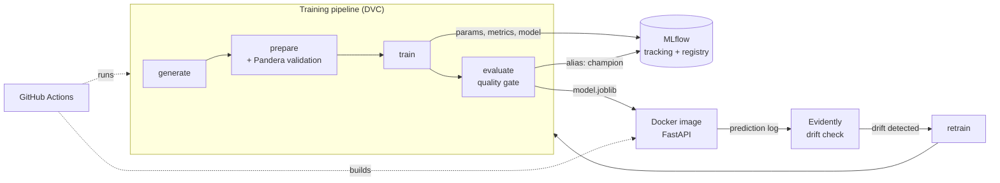

# MLOps Churn: an end-to-end MLOps starter

[](https://github.com/perpetualxbeta-ai/mlops-churn/actions/workflows/ci.yml)

This project predicts which telecom customers will churn. The model is deliberately
simple. **The point is everything around it:** reproducible pipelines, data and model
versioning, experiment tracking, automated quality gates, containerised serving, and
drift monitoring that can trigger retraining.

Everything runs locally and for free. You need no cloud account and no dataset
download: the data is generated synthetically so the whole pipeline can be rebuilt
from scratch, including in CI.

## Architecture



| Concern | Tool | Where |
|---|---|---|
| Config | YAML | [`params.yaml`](params.yaml) |
| Pipeline and data versioning | DVC | [`dvc.yaml`](dvc.yaml), `dvc.lock` |
| Data validation | Pandera | [`src/churn/data/validate.py`](src/churn/data/validate.py) |
| Experiment tracking and model registry | MLflow | [`src/churn/train.py`](src/churn/train.py), [`evaluate.py`](src/churn/evaluate.py) |
| Serving | FastAPI + Pydantic | [`src/churn/serve/`](src/churn/serve) |
| Packaging | Docker, Compose | [`Dockerfile`](Dockerfile), [`docker-compose.yml`](docker-compose.yml) |
| CI/CD | GitHub Actions | [`.github/workflows/`](.github/workflows) |
| Monitoring | Evidently | [`src/churn/monitoring/drift.py`](src/churn/monitoring/drift.py) |
| Tests | pytest | [`tests/`](tests) |

## Quickstart

Requires Python 3.11+ (and Docker for stage 4).

```bash
git clone https://github.com/perpetualxbeta-ai/mlops-churn.git
cd mlops-churn
python -m venv .venv && source .venv/bin/activate   # Windows: .venv\Scripts\activate
make install          # or: pip install -e ".[dev]"

make pipeline         # generate -> prepare -> train -> evaluate
make test             # 19 tests: data, model, API, drift
make serve            # API at http://localhost:8000/docs
```

Run `make help` to list every command.

## Learn it stage by stage

Work through these in order. Each stage maps to one core MLOps idea.

### 1. Reproducible training

All settings live in `params.yaml`. Data generation, the train/test split and the model
all use fixed seeds, so the same commit always produces the same model.

**Try:** run `make pipeline` twice. The second run skips generate, prepare and train because
nothing changed. Only `evaluate` re-runs, because the quality gate is marked `always_changed`.

### 2. Pipeline and data versioning with DVC

`dvc.yaml` defines the pipeline as a DAG. DVC hashes every input (code, data, params)
and records them in `dvc.lock`. It re-runs only the stages affected by a change.

```bash
dvc dag                                       # draw the pipeline
dvc repro -S train.model=logistic_regression  # change a param; only train + evaluate re-run
dvc params diff                               # what changed vs the last commit
dvc metrics diff                              # how metrics moved
```

**Try:** break the data contract. Edit `generate.py` to produce a negative tenure, run
`dvc repro`, and watch the `prepare` stage refuse the data.

### 3. Experiment tracking and the model registry with MLflow

Every training run logs params, cross-validation scores, test metrics, the git commit and
the model. The run registers a new version of `churn-classifier`. If the version clears the
quality gate, `evaluate.py` points the **`champion`** alias at it.

```bash
make mlflow-ui    # http://localhost:5000
```

**Try:** run a few experiments with different models and hyperparameters, then compare
them side by side in the UI:

```bash
dvc repro -S train.random_forest.max_depth=4
dvc repro -S train.random_forest.max_depth=12
dvc repro -S train.model=logistic_regression
```

### 4. Serving with FastAPI and Docker

The API loads one scikit-learn `Pipeline` that bundles preprocessing with the model. That
prevents training/serving skew. Pydantic rejects invalid input with a 422 before it reaches
the model.

```bash
curl -X POST localhost:8000/predict -H 'Content-Type: application/json' -d '{
  "tenure_months": 2, "monthly_charges": 95, "support_calls": 4, "senior_citizen": 0,
  "contract": "month_to_month", "internet_service": "fiber", "payment_method": "electronic_check"
}'
# {"churn_probability":0.9034,"will_churn":true,"model_version":"local"}
```

```bash
make up      # API on :8000 + MLflow tracking server on :5000
make down
```

### 5. CI/CD with GitHub Actions

| Workflow | Trigger | What it does |
|---|---|---|
| [`ci.yml`](.github/workflows/ci.yml) | push, PR | lint, then tests, then `dvc repro`. **Fails if test ROC-AUC < `evaluate.min_roc_auc`.** Posts metrics (and the diff vs `main` on PRs) to the job summary, then builds the image and smoke-tests it. |
| [`release.yml`](.github/workflows/release.yml) | tag `v*` | trains, gates, then pushes the image to `ghcr.io/perpetualxbeta-ai/mlops-churn` |
| [`monitor.yml`](.github/workflows/monitor.yml) | manual or cron | drift check, then retrains if drift is found |

**Try:** open a PR that raises `min_roc_auc` to `0.95` and watch the quality gate block it.
Then open a PR that changes a hyperparameter and read the metrics diff in the job summary.

### 6. Monitoring data drift with Evidently

The API appends every request to `logs/predictions.jsonl`. The drift check compares that
log with the training data, column by column, and writes `reports/drift.html`.

```bash
make serve                 # terminal 1
make traffic && make drift # terminal 2: normal traffic -> no drift
make clean
make traffic-drift && make drift  # newer, pricier, month-to-month customers -> DRIFT
```

```
  DRIFT  tenure_months      Wasserstein distance (normed)
  DRIFT  monthly_charges    Wasserstein distance (normed)
  ok     support_calls      Wasserstein distance (normed)
  ok     senior_citizen     Jensen-Shannon distance
  DRIFT  contract           Jensen-Shannon distance
  DRIFT  internet_service   Jensen-Shannon distance
  ok     payment_method     Jensen-Shannon distance
Drifted columns: 4/7 (share 0.571, limit 0.3)
DATASET DRIFT DETECTED: consider retraining.
```

### 7. Closing the loop: retraining

`monitor.yml` runs the drift check. If drift is detected, it retrains the model and runs it
back through the quality gate. Open **Actions → Monitor & retrain → Run workflow** to try it.

## Project layout

```
├── params.yaml               # all pipeline config
├── dvc.yaml / dvc.lock       # pipeline DAG + exact versions of every input/output
├── src/churn/
│   ├── data/                 # generate, validate (Pandera), prepare (split)
│   ├── model.py              # preprocessing + estimator Pipeline
│   ├── train.py              # train + MLflow logging + registration
│   ├── evaluate.py           # test metrics + quality gate + champion alias
│   ├── serve/                # FastAPI app and Pydantic schemas
│   └── monitoring/drift.py   # Evidently drift report
├── scripts/send_traffic.py   # simulate production requests
├── tests/                    # data, model (incl. behavioural), API, drift
├── Dockerfile, docker-compose.yml
└── .github/workflows/        # ci, release, monitor
```

## Next exercises

Once the basics work, extend the project:

- [ ] **Real data.** Swap the generator for the [IBM Telco Customer Churn](https://www.kaggle.com/datasets/blastchar/telco-customer-churn) dataset. Track it with `dvc add` and push it to a DVC remote (S3, GCS or Google Drive).
- [ ] **Champion vs. challenger.** Only promote a new model if it beats the current `champion` in the registry, not just a fixed threshold.
- [ ] **Serve from the registry.** Load `models:/churn-classifier@champion` at startup instead of a file.
- [ ] **Metrics endpoint.** Add `prometheus-fastapi-instrumentator` and a Grafana dashboard to `docker-compose.yml`.
- [ ] **Hyperparameter search.** Use Optuna, with each trial logged as an MLflow child run.
- [ ] **Model explainability.** Log SHAP plots as MLflow artifacts.
- [ ] **Orchestration.** Rewrite the pipeline as a Prefect flow.
- [ ] **Kubernetes.** Deploy the image to a local `kind` cluster.
